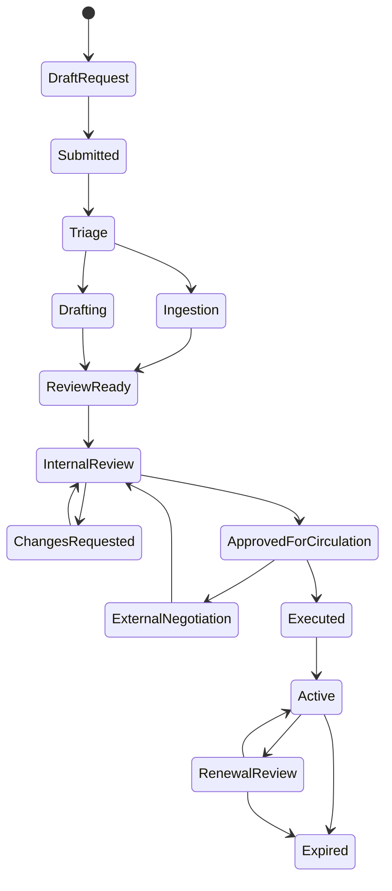
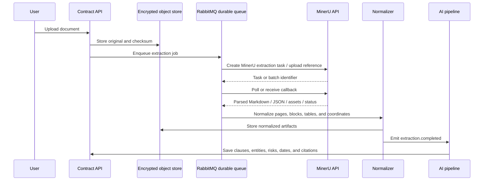
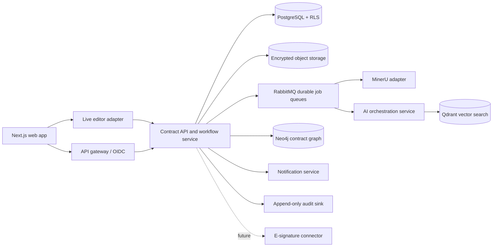

# Capco AI Legal Contract Compliance Assistant

## 1. Purpose and design direction

This document defines the product and technical design for a Capco contract lifecycle workspace. It is a greenfield design based on the supplied reference screens and product notes. The experience should feel like a focused legal operations workspace: a persistent left navigation, a calm document canvas, and an AI assistant that works beside the contract rather than taking the user away from it.

The initial operating context is Capco and Wipro work across Hong Kong and the United Kingdom. The model must therefore support organization-specific playbooks, legal entities, governing-law variants, and cross-border data controls from the beginning.

### Goals

- Give business users a guided way to submit and track contract requests.
- Ingest existing agreements, including scans, with MinerU for OCR and layout-aware parsing.
- Generate first drafts from the existing template catalog in the live editor using structured fields.
- Review third-party paper against Capco playbooks and explain deviations with clause-level citations.
- Provide assisted redlining, comments, approvals, version history, and auditability.
- Extract obligations, dates, renewal windows, and financial terms into a searchable repository.
- Let legal and operations teams search across contracts using natural language and structured filters.
- Run the complete application stack through Docker-based local and deployment environments.
- Keep e-signature as a future connector with a stable handoff point, without making it part of the first release.

### Non-goals for the first release

- Native legally binding e-signature or signature certificate issuance.
- Replacing legal judgment with autonomous approval or autonomous negotiation.
- Training a foundation model on customer contract content.
- A general-purpose document editor unrelated to contracts.

## 2. Product principles

1. **Evidence before assertion.** Every material AI finding links to the source document, page, section, and extracted text span.
2. **Human gates for legal decisions.** AI can propose, classify, and summarize; a named user accepts, rejects, or edits consequential changes.
3. **Structured where possible.** Dates, parties, amounts, obligations, risks, and approvals are stored as typed records rather than only as chat text.
4. **Jurisdiction is first-class.** A playbook is selected by agreement type, entity, governing law, and region.
5. **A contract has a history.** Immutable audit events and versioned artifacts are part of every workflow.
6. **Progressive disclosure.** The home screen is simple for requestors; legal users can open deeper clause, source, and workflow detail.

## 3. Users and permissions

| Role | Main actions | Typical scope |
| --- | --- | --- |
| Requestor | Create requests, upload documents, answer questions, view status | Own requests and permitted business unit |
| Contract manager | Triage requests, assign owners, manage dates, coordinate approvals | Business unit or portfolio |
| Legal reviewer | Configure playbooks, review clauses, redline, approve or return | Assigned matters or jurisdiction |
| Business approver | Review commercial or operational decisions | Assigned approval step |
| Repository manager | Curate templates, clauses, metadata, retention, and links | Organization or region |
| Administrator | Manage users, roles, entities, integrations, policies, and audit access | Tenant |
| Auditor | Read-only access to records and audit history | Explicitly granted scope |

Use organization, business unit, legal entity, and matter-level permissions. Store the permission decision with every document and workflow request so access remains explainable after role changes.

## 4. Information architecture and screens

### Persistent navigation

The main shell follows the reference layout:

- **My Work:** assigned requests, drafts awaiting action, recent contracts, and upcoming deadlines.
- **Inbox:** mentions, review tasks, approval requests, and AI processing exceptions.
- **Create:** new request, upload for review, create from template, or start a repository search.
- **Alerts:** renewals, missing metadata, playbook breaches, overdue approvals, and failed extraction.
- **Requests:** list and board views with filters for status, owner, entity, type, and due date.
- **My Drive:** contracts, templates, clause library, and related supporting documents.
- **Reports:** portfolio risk, cycle time, obligations, renewals, and playbook adherence.
- **Settings:** users, entities, jurisdictions, playbooks, integrations, retention, and model policy.

The sidebar should collapse to icons while preserving tooltips and an accessible keyboard path. The top bar contains global contract search, current workspace context, notifications, and the signed-in user menu.

### Home / My Work

The first screen should combine the visual hierarchy shown in the reference landing screen with Capco-specific data:

1. Greeting and a short prompt such as “What would you like to accomplish today?”
2. Quick starts: NDA, MSA, SOW, vendor agreement, employment agreement, license agreement, and “Browse templates”.
3. Conversational intake box with upload, source selection, and suggested prompts.
4. Core workflow tiles: Create request, Draft and review, Analyze an agreement, and Track obligations.
5. A compact work queue showing the user’s next actions and deadlines.

The assistant should route a prompt into an explicit workflow. For example, “Review this supplier MSA against the UK procurement playbook” opens upload, confirms the entity and governing law, and creates a review matter rather than leaving the request as an unstructured chat.

### Create request

Use a two-column form consistent with the supplied request screen:

- Agreement category, agreement type, request type, contract type, legal entity, business unit, region, title, and legal scope.
- Due date, assignee, related request, template, linked partner, existing document, and supporting files.
- Optional calendar and reminder settings.

The form should save drafts, validate required fields, show a clear processing state after submission, and assign a request ID. A short onboarding panel may explain assignment, due dates, linked documents, and notifications, but it must be dismissible and never block the form.

### Contract workspace

The contract workspace is the primary legal surface:

- Center: the LeggItAI-compatible live editor with headings, tables, inline comments, tracked changes, search, zoom, clause anchors, and field highlighting.
- Top: title, status, save state, version selector, compare action, and export action.
- Right panel: AI chat, sources, comments, variables, workflow, version history, and contract information.
- Bottom composer: “Ask, search, or make anything...” with three explicit modes: Understand and assess, Improve and act, and Sources.

The AI panel must support streaming responses, citations, related queries, retry, feedback, copy, and “show in document”. A response that changes text produces a proposed patch or redline; it never silently rewrites the saved contract.

The editor is template-driven. A document starts from a template version and is rendered as editable content blocks plus typed fields. The editor must preserve field identity when text is edited so a value can be updated from the Variables panel, an AI suggestion, or an integration without replacing unrelated text. If the LeggItAI live editor is exposed as an embeddable product or API, use it as the primary editing surface; keep an internal editor adapter behind the same contract so the rest of the application does not depend on editor-specific document formats.

### Templates, fields, and variables

Templates contain approved clause blocks, layout/content blocks, and typed fields. A field is the reusable unit that connects a visible placeholder in the live editor to structured contract data. The variables panel displays missing values such as party names, jurisdiction, addresses, dates, amounts, term, renewal period, and notice periods. Each field records its source: user input, extracted value, linked CRM data, AI proposal, or reviewer override.

Support at least these field types: short text, long text, person or company, address, date, duration, currency amount, percentage, number, single select, multi-select, yes/no, and repeatable list. Fields have a stable key, display label, help text, required flag, validation rule, default value, jurisdiction/entity scope, and sensitivity classification. A field may be used in multiple locations in a template; changing it updates all linked locations after confirmation.

Field states are `missing`, `suggested`, `filled`, `needs_review`, and `locked`. Extracted values and AI proposals remain suggestions until a user confirms them. Locked fields can only be changed by an authorized reviewer and the change is audited. Conditional blocks can show or hide clauses based on field values, while repeatable blocks support schedules, deliverables, and party lists.

Template versions are immutable. Publishing a new template creates a new version and records the approver, effective date, jurisdictions, and superseded version.

The template catalog should support Capco's existing library rather than assuming that every document is generated from scratch. Each template stores its source editor document, rendered preview, clause references, field schema, allowed jurisdictions, owner, lifecycle status, and effective date. Users can start from a template, clone it into a matter, or upload an existing agreement for review without losing the source document.

### Review and clause analysis

The review view groups findings by clause and category, following the reference “Clause Analysis” pattern:

- Preamble and parties
- Definitions
- Confidentiality
- Intellectual property
- Data protection and security
- Term, termination, and renewal
- Fees, payment, tax, and audit
- Indemnity and limitation of liability
- Service levels and deliverables
- Governing law, dispute resolution, and notices

Each finding shows severity, playbook position, detected language, explanation, recommended fallback, confidence, and source citation. Findings can be accepted, dismissed with reason, assigned, or converted into a redline task.

### Workflow and approvals

The workflow panel shows a numbered progression similar to the supplied design:

1. Collaborators and approvers
2. Internal sign-off steps
3. FYI recipients / CCs
4. Post-approval actions

For the initial release, the final action is “Approved for signature” or “Approved for external circulation”. A future e-signature adapter can attach after this state. Every transition requires an actor, timestamp, reason when applicable, and the document version being approved.

### Obligations and renewals

The obligations view presents a table and timeline with:

- Obligation text and source clause
- Responsible party and internal owner
- Start date, due date, recurrence, and notice period
- Status, evidence, last completion, and next reminder
- Linked contract, SOW, amendment, purchase order, or ticket

Renewal alerts should be generated from extracted dates plus a configurable notice window, with an explicit confidence and review state when a date is inferred.

## 5. Contract lifecycle



`Executed` is reserved for a future e-signature or verified externally signed artifact. In the first release, the user can mark a document as externally executed and upload evidence, but the product must label that state clearly and retain the evidence file.

## 6. Functional requirements

### Intake and generation

- Create a request from a form, quick start, API, or natural-language prompt.
- Ask only for missing information and persist answers as typed variables.
- Select a template based on agreement type, entity, business unit, and governing law.
- Assemble only approved, effective clause versions.
- Generate a draft in the live editor with a provenance record for every inserted clause and field value.
- Show the selected template version and all missing or suggested fields before the draft is sent for review.
- Support field validation, repeated fields, conditional clauses, and synchronized values across all field occurrences.
- Preserve editor-native comments, tracked changes, and field anchors when saving a new contract version.

### Live editor integration

- Treat the LeggItAI live editor as a first-class integration, not only as a visual reference.
- Define an `EditorProvider` interface for open, create-from-template, load, save-version, apply-field-update, apply-redline, compare, comment, and export operations.
- Store the provider document ID, editor schema version, template version, and last synchronized contract version.
- Use a webhook or event bridge for editor changes so autosave, comments, and tracked changes become auditable application events.
- Prevent silent divergence: a save must either succeed in both the editor and the contract service or be marked as a recoverable synchronization conflict.
- Keep an export path to DOCX and PDF for review and external circulation, while retaining the editor-native source as the canonical editable artifact.

### Document ingestion

- Accept PDF, DOCX, PPTX, XLSX, and image files subject to configured limits.
- Detect password protection, corruption, duplicate files, and unsupported encryption.
- Preserve original bytes, checksum, uploader, source, and retention policy.
- Run MinerU for OCR, layout detection, reading order, tables, images, and structured text.
- Preserve page coordinates and source spans for citations and “show in document”.
- Allow a reviewer to correct extraction and mark the correction as human verified.

### Review and redlining

- Run a playbook check after ingestion or on demand.
- Detect missing, contradictory, unusual, or prohibited positions.
- Generate structured findings and suggested fallback text.
- Apply accepted suggestions as tracked changes with a clear author identity: “AI suggestion, accepted by [user]”.
- Compare any two versions at clause and text level.
- Keep comments and decisions attached to stable clause or text anchors where possible.

### Repository and search

- Full-text, metadata, hybrid semantic search, and natural-language search.
- Filters for entity, region, governing law, agreement type, owner, status, risk, dates, and counterparties.
- Search results show permission-aware snippets and source locations.
- Link related documents into a contract family graph.

### Obligations and alerts

- Extract dates, notice periods, payment schedules, service levels, deliverables, audit rights, indemnities, and termination triggers.
- Require confirmation before creating a high-impact alert from low-confidence extraction.
- Support reminders, escalations, snooze, completion evidence, and overdue reporting.

## 7. MinerU ingestion design

MinerU is the canonical OCR and layout extraction service for the first release. Docling is not part of the design. The implementation reference is the [MinerU API documentation](https://mineru.net/apiManage/docs).

### Boundary

Create an internal `DocumentExtractionProvider` interface so the rest of the system depends on normalized extraction output rather than MinerU-specific payloads. The initial implementation is `MinerUProvider`; a future private or self-hosted parser can implement the same interface if data residency or availability requirements change.

### Processing flow



### Production API profile

Use MinerU's authenticated **Precise Extraction API** for contract files. It supports PDF, common Office formats, and images up to 200 MB and 200 pages. Use `vlm` for difficult scans and mixed layouts; use `pipeline` where throughput and predictable cost are more important. Set `is_ocr=true` for scanned or image-heavy documents and keep table recognition enabled for schedules and pricing exhibits. The API can return Markdown and JSON by default, with optional DOCX, HTML, or LaTeX exports.

There are two supported submission paths:

- **URL submission:** `POST /api/v4/extract/task` for one file or `POST /api/v4/extract/task/batch` for multiple accessible URLs. The request includes a Bearer token, source URL, model version, and optional OCR, language, page-range, callback, and format settings.
- **Local-file submission:** `POST /api/v4/file-urls/batch` to obtain signed upload URLs, then `PUT` each file to its returned URL. The signed URLs are valid for 24 hours; a request can contain up to 50 files, and the upload itself does not need a `Content-Type` header. Upload completion automatically starts extraction.

Poll single tasks with `GET /api/v4/extract/task/{task_id}` or batches with `GET /api/v4/extract-results/batch/{batch_id}`. Map provider states such as `pending`, `running`, `converting`, `done`, and `failed` to the product states defined below. A completed precise-API task returns a result ZIP containing `full.md` plus structured JSON artifacts such as layout and content-list data; download and checksum the ZIP before normalization.

### MinerU adapter responsibilities

The adapter should:

- Read the API token from a secret manager, never from client code or a contract record.
- Create a task using the configured MinerU API version and selected model/options.
- Prefer the signed local-file upload flow for user uploads so a private contract is not exposed through a third-party URL fetch. Use URL submission only for an approved, reachable source.
- Support the documented upload flow, including signed upload URLs and the 24-hour expiry window.
- Pass a stable `data_id` linked to the internal document ID for traceability.
- Supply a callback URL plus a random `seed` when callbacks are enabled. Verify MinerU's SHA-256 callback checksum using the tenant's MinerU user ID before accepting the result; otherwise poll the task endpoint.
- Persist the provider task ID, request payload hash, status, attempt count, and timestamps.
- Poll with exponential backoff or process a signed callback if the selected MinerU endpoint supports callbacks.
- Download result artifacts into the encrypted object store before parsing them further.
- Verify content type, size, checksum, and expected result structure.
- Treat provider output as untrusted input and sanitize embedded HTML, links, and instructions.
- Retry transient failures, dead-letter permanent failures, and surface a user-readable exception.
- Retain the original and provider output according to the contract retention policy.

Keep endpoint paths, request fields, limits, and callback verification in one adapter module and cover them with contract tests against a mocked provider. The product API should expose stable states such as `queued`, `extracting`, `needs_review`, `ready`, and `failed`, regardless of provider terminology. The unauthenticated Agent Lightweight API is not the default for contract ingestion because it is limited to 10 MB and 20 pages and returns Markdown only; reserve it for a separately approved low-risk workflow.

### Normalized extraction model

Normalize MinerU output into:

- `DocumentPage`: page number, width, height, rendered preview, and source checksum.
- `LayoutBlock`: block type, text, bounding box, reading order, page, and confidence.
- `Table`: cells, row/column spans, source page, and rendered asset.
- `Section`: heading, normalized number, parent section, start/end page, and text span.
- `Clause`: stable internal ID, section path, text, source spans, and embedding status.
- `Asset`: image or attachment references with safe MIME type and checksum.

Legal chunking should follow `section -> clause -> sub-clause`, with overlap only when a definition or exception crosses a boundary. Store clause metadata alongside embeddings so retrieval can filter by agreement type, jurisdiction, entity, and playbook version.

## 8. AI and compliance architecture

Use a workflow-oriented orchestrator rather than an unconstrained autonomous agent. Each workflow emits typed events and pauses for a human gate where needed.

### Core AI workflows

1. **Intake assistant:** turns a prompt into a request, asks clarifying questions, and selects a workflow.
2. **Drafting assistant:** fills approved templates and proposes clause alternatives from the permitted library.
3. **Extraction workflow:** identifies parties, dates, terms, obligations, financial terms, and relationships.
4. **Playbook reviewer:** retrieves applicable rules, evaluates clauses, and produces structured findings.
5. **Redline assistant:** proposes minimal changes, explains impact, and preserves accepted/rejected decisions.
6. **Repository assistant:** answers questions using permission-aware retrieval with citations.
7. **Obligation monitor:** creates and updates tasks from confirmed extracted obligations.

### Deterministic compliance checks

Use rules for checks that should not depend on model wording, including:

- governing-law and entity compatibility;
- liability cap thresholds and carve-outs;
- required data-processing language;
- minimum insurance or security requirements;
- notice periods and renewal windows;
- payment terms and approval thresholds;
- required clause presence;
- prohibited party, sanctions, or missing counterparty metadata.

The model explains and proposes; deterministic rules decide whether a threshold or required condition was met.

### Structured finding

```json
{
  "finding_id": "finding_01J...",
  "clause_id": "clause_8_1",
  "category": "limitation_of_liability",
  "severity": "high",
  "status": "open",
  "detected_position": "No aggregate liability cap; indirect damages exclusion is absent",
  "playbook_position": "Cap liability at agreed fees with defined carve-outs",
  "recommendation": "Insert the current Capco UK fallback clause",
  "confidence": 0.93,
  "sources": [{"page": 7, "quote": "...", "char_start": 12, "char_end": 96}],
  "requires_human_decision": true
}
```

Prompts, model name, retrieval set, playbook version, and output schema version must be recorded with every AI run. Model output must be validated against Pydantic or equivalent schemas before it can change a workflow record.

## 9. High-level architecture



### Recommended components

| Concern | Recommendation |
| --- | --- |
| Web app | Next.js App Router, TypeScript, Tailwind, accessible component library |
| Editor | LeggItAI live editor through an `EditorProvider` adapter; retain an internal fallback only if the integration lacks a required capability |
| API | FastAPI, Pydantic, async SQLAlchemy/SQLModel |
| Long-running work | RabbitMQ durable queues with publisher confirms, manual acknowledgements, retry queues, and dead-letter exchanges |
| Workflow orchestration | Temporal can coordinate multi-step workflows later; workers consume RabbitMQ jobs and persist state in PostgreSQL |
| System of record | PostgreSQL with Row-Level Security for tenants, matters, templates, fields, versions, workflows, and audit metadata |
| Vector search | Qdrant for clause, playbook, template, and document embeddings |
| Contract graph | Neo4j for contract families, parties, amendments, SOWs, obligations, and cross-document relationships |
| Object storage | S3-compatible storage with versioning, encryption, and object lock where required |
| Search | PostgreSQL metadata/full text plus Qdrant semantic retrieval, with permission filters applied before results are shown |
| Identity | OIDC with Capco identity provider or Azure AD; SCIM for user lifecycle |
| AI gateway | Azure OpenAI or approved private model endpoint with no-training and retention controls |
| Notifications | Email and in-app notifications, with calendar integration as a later connector |

PostgreSQL remains the transactional source of truth. Qdrant and Neo4j are projections: every vector or graph record includes the source tenant, contract/version ID, source revision, and index version so projections can be rebuilt from PostgreSQL and object storage.

### Docker deployment baseline

Every service should run in a container, with a Docker Compose profile for local development and a production deployment path that preserves the same service boundaries. The baseline stack is:

| Service | Container responsibility | Persistent data |
| --- | --- | --- |
| `web` | Next.js application and live editor integration UI | None |
| `api` | FastAPI contract, template, field, workflow, and authorization APIs | None |
| `worker` | MinerU jobs, AI workflows, indexing, notifications, exports, and projections | None |
| `postgres` | Transactional records, RLS, template/field schemas, versions, approvals, and audit metadata | Named PostgreSQL volume |
| `qdrant` | Vector collections for clauses, playbooks, templates, and extracted content | Named Qdrant volume |
| `neo4j` | Contract family and obligation relationship graph | Named Neo4j data/log/plugins volumes |
| `rabbitmq` | Durable long-running job queues, exchanges, retries, and dead-letter routing | Named RabbitMQ volume |
| `redis` | Optional short-lived cache, locks, and rate limits; not the source of durable jobs | Disposable development volume or named volume when required |
| `minio` or S3 | Original files, MinerU result ZIPs, editor exports, and evidence packages | Named object-store volume in local development |

The Compose file should define a private application network, health checks, explicit service dependencies, resource limits, named volumes, and environment-variable references rather than inline secrets. Use separate `dev`, `test`, and `prod-like` profiles. Production should move managed or clustered stateful services out of a single host when availability, backup, or residency requirements demand it, while keeping the same connection contracts.

Backups must cover PostgreSQL, Qdrant snapshots, Neo4j dumps, RabbitMQ definitions and durable queue configuration, and object storage versioning. Restore tests should rebuild Qdrant and Neo4j from PostgreSQL/object-store records and verify that tenant isolation and document citations still work.

### Long-running job processing with RabbitMQ

RabbitMQ is the durable handoff point for work that can take seconds to hours. The API records a job in PostgreSQL, publishes a message using the transactional outbox pattern, and immediately returns a job ID. Workers acknowledge a message only after the result and job state have been committed. The UI reads progress from PostgreSQL and receives live updates through SSE; it never waits on an HTTP request for MinerU, AI, indexing, or export work.

Use durable exchanges and quorum queues for production. Start with queues for `document.extract`, `document.normalize`, `ai.review`, `index.vector`, `index.graph`, `document.export`, and `notifications`. Each message includes a schema version, job ID, tenant ID, matter/contract ID, source revision, artifact references, correlation ID, and idempotency key. Do not put contract text or binary files directly in the message; keep them in object storage and pass references.

Configure publisher confirms, persistent messages, bounded prefetch, manual acknowledgements, consumer heartbeats, and graceful shutdown. Transient failures move through delayed retry queues with an attempt count and backoff. Permanent failures route to a dead-letter exchange and create a visible support item; operators can replay a dead-lettered job after correcting the cause. Workers must be idempotent because a message can be delivered again after a crash.

Use the PostgreSQL outbox and job tables to make submission recoverable: a committed database record without a published message is republished by a relay, and a published message without a successful worker commit is safe to retry. Temporal remains an optional coordination layer for complex human-in-the-loop workflows; RabbitMQ remains the transport for the long-running worker tasks.

## 10. Core data model

Key entities:

- `tenant`, `organization`, `business_unit`, `legal_entity`, `jurisdiction`
- `user`, `role`, `permission`, `team`
- `matter` / `request`, `request_participant`, `request_status_event`
- `contract`, `contract_version`, `document_artifact`, `document_page`, `layout_block`, `editor_document`
- `section`, `clause`, `clause_anchor`, `document_relation`
- `template`, `template_version`, `template_content_block`, `clause_library_entry`
- `field_definition`, `field_binding`, `field_value`, `field_value_revision`, `variable_definition`, `variable_value`
- `playbook`, `playbook_version`, `playbook_rule`, `finding`, `redline_suggestion`
- `comment`, `approval_step`, `approval_decision`, `workflow_run`
- `obligation`, `obligation_evidence`, `renewal_event`, `notification`
- `embedding`, `qdrant_collection`, `neo4j_projection_record`, `search_index_record`, `ai_run`, `ai_citation`
- `job`, `job_attempt`, `outbox_event`, `dead_letter_event`
- `audit_event`, `retention_policy`, `integration_connection`

Every tenant-owned table carries `tenant_id`. Sensitive records additionally carry `matter_id` or `contract_id`, and all read/write paths enforce both application authorization and database RLS.

`field_binding` connects a template field to one or more editor locations using stable provider anchors. `field_value_revision` records the old value, new value, source, actor, contract version, and validation result. This lets a user change a field once while preserving a complete history of how the live document changed.

`job` is the user-visible long-running operation record; `job_attempt` records worker delivery, retry, timing, and error details. `outbox_event` links a committed PostgreSQL state change to a RabbitMQ publication, and `dead_letter_event` records jobs that require operator review or replay.

## 11. Internal API surface

Illustrative endpoints; the final API should be versioned under `/api/v1`.

| Area | Endpoints |
| --- | --- |
| Requests | `POST /requests`, `GET /requests`, `GET /requests/{id}`, `POST /requests/{id}/submit` |
| Uploads | `POST /documents/upload-url`, `POST /documents/{id}/process`, `GET /documents/{id}/status` |
| Contracts | `GET /contracts`, `GET /contracts/{id}`, `POST /contracts/{id}/versions`, `POST /contracts/{id}/compare` |
| Live editor | `POST /contracts/{id}/editor/open`, `POST /contracts/{id}/editor/save`, `POST /contracts/{id}/fields/{field_key}`, `POST /contracts/{id}/editor/redlines` |
| Templates and fields | `GET/POST /templates`, `GET /templates/{id}/schema`, `POST /templates/{id}/publish`, `GET/POST /contracts/{id}/field-values` |
| AI | `POST /contracts/{id}/ai-runs`, `GET /ai-runs/{id}`, `POST /findings/{id}/decision` |
| Redlines | `POST /redlines`, `POST /redlines/{id}/accept`, `POST /redlines/{id}/reject` |
| Workflow | `POST /matters/{id}/approvals`, `POST /approvals/{id}/decision` |
| Obligations | `GET /obligations`, `POST /obligations/{id}/complete`, `POST /obligations/{id}/snooze` |
| Search | `POST /search`, `GET /contracts/{id}/sources/{source_id}` |
| Admin | `GET/POST /playbooks`, `GET/POST /templates`, `GET/POST /integrations` |

Use SSE for streaming assistant output and job progress. Use webhooks for external systems. All mutations should accept an idempotency key and return a correlation ID.

## 12. Security, privacy, and governance

- Encrypt in transit and at rest; use customer-managed keys where the deployment requires it.
- Keep MinerU credentials and model provider credentials in a secret manager.
- Do not send documents to an external provider until the tenant policy and document classification allow it.
- Make data residency explicit: configure Hong Kong or UK/EU storage and processing regions per tenant or legal entity.
- Support Capco policy controls for UK GDPR, GDPR, and Hong Kong PDPO obligations, including retention, deletion, access export, and purpose limitation.
- Redact or tokenize unnecessary personal data before optional external AI processing.
- Prevent model training on customer content and record provider retention settings.
- Apply malware scanning and content-type validation before parsing.
- Treat uploaded documents, extracted text, prompts, and model output as untrusted input; defend against prompt injection and indirect instructions in documents.
- Use append-only audit events for upload, view, download, share, AI run, finding decision, edit, approval, export, deletion, and permission change.
- Support legal hold that overrides ordinary deletion until released.
- Restrict exports and bulk download by role, with reason capture for sensitive portfolios.

## 13. Reliability and observability

Track:

- ingestion success rate, extraction latency, OCR confidence, and pages processed;
- AI run latency, schema validation failures, citation coverage, and human override rate;
- review cycle time, findings by severity, approval SLA, and renewal alert accuracy;
- queue depth, provider errors, retry count, dead-letter jobs, and webhook failures.

Every user-visible job has a correlation ID and a support-safe error message. Logs must omit contract content by default and use structured metadata. Keep a replayable job record without allowing an operator to expose document text accidentally.

## 14. Delivery roadmap

### Phase 0: foundation

- Tenant, identity, roles, entities, jurisdictions, audit events, object storage, and basic request records.
- Design system shell, navigation, accessibility, and responsive behavior.
- MinerU adapter spike with representative Capco documents and extraction quality baseline.
- Docker Compose baseline with PostgreSQL, Qdrant, Neo4j, RabbitMQ, optional Redis, object storage, API, worker, and web services.
- RabbitMQ long-running job flow with durable queues, outbox publishing, retries, dead-letter routing, idempotent workers, and visible job progress.
- Live editor integration spike covering template load, field binding, autosave, comments, tracked changes, and export.

### Phase 1: first usable release, no native e-signature

- Home dashboard, create request, upload, MinerU processing, normalized document model.
- Contract workspace with the live editor, sources, AI chat, fields, versioning, comments, and compare.
- Existing template catalog ingestion, template versioning, field schema, field validation, clause library, playbooks, structured findings, and accepted redlines.
- PostgreSQL transactions with Qdrant embeddings and Neo4j contract-family projections.
- Approval workflow ending at “Approved for external circulation”.
- Repository search, obligation extraction, renewal alerts, and reports.

### Phase 2: scale and collaboration

- Bulk analysis, batch ingestion, CRM/procurement connectors, richer portfolio analytics.
- Office integration or high-fidelity DOCX round trip if the live editor export is insufficient.
- Advanced contract family graph, delegation, external collaboration, and regional policy packs.

### Phase 3: e-signature integration

- Provider adapter for DocuSign, Adobe Acrobat Sign, or an approved regional provider.
- Recipient order, authentication, signing ceremony status, completion certificate, and webhook reconciliation.
- Immutable execution package linked to the approved version and audit trail.

E-signature should attach to the existing `ApprovedForCirculation` state through an interface such as `SignatureProvider`. It should not require changes to clause analysis, repository search, or obligation extraction.

## 15. Acceptance criteria for Phase 1

- A requestor can create a request, upload a scanned agreement, and see processing progress.
- MinerU output is stored with the original file and can be traced to page-level citations.
- A reviewer can open a clause finding, inspect the source, accept or reject a fallback, and see the decision in audit history.
- A draft can be generated from an approved template in the live editor using typed fields and saved as a versioned document.
- A field can be updated once and all of its bound editor locations update together after validation, with a field-value audit record.
- Template versions show their effective date, jurisdiction, owner, clause references, and field schema before they can be used.
- Two versions can be compared and the user can navigate from a change to its clause.
- At least one approval workflow can be configured and completed without signature integration.
- Confirmed obligations produce reminders and show their source clause.
- Search respects tenant and matter permissions.
- A fresh Docker Compose environment starts PostgreSQL, Qdrant, Neo4j, RabbitMQ, object storage, API, worker, and web services with health checks; Redis is optional for ephemeral caching and locks.
- A long-running MinerU or AI job survives an API restart, can be retried after a worker failure, and appears as a recoverable status record in the UI.
- Qdrant and Neo4j records can be rebuilt from the transactional and object-store data without losing tenant filters or citations.
- A user can export a contract and its evidence package with an audit record.
- A failed MinerU job is retryable and understandable to the user without exposing provider secrets.

## 16. Decisions to confirm before implementation

1. Which identity provider and tenant boundary will be used for Capco and Wipro users?
2. Which documents may be processed by the hosted MinerU API, and which require an in-region or self-hosted deployment?
3. Which LeggItAI live editor integration surface is available: embed, API, webhook, or export/import?
4. Which existing template catalog should be imported first, and which fields and conditional blocks are authoritative?
5. Which Capco playbooks and clause libraries are authoritative for Hong Kong, UK, and cross-border matters?
6. What retention, legal hold, and deletion rules apply by agreement category?
7. Which notification channels are permitted for legal deadlines?
8. Which e-signature provider should be evaluated for Phase 3?

